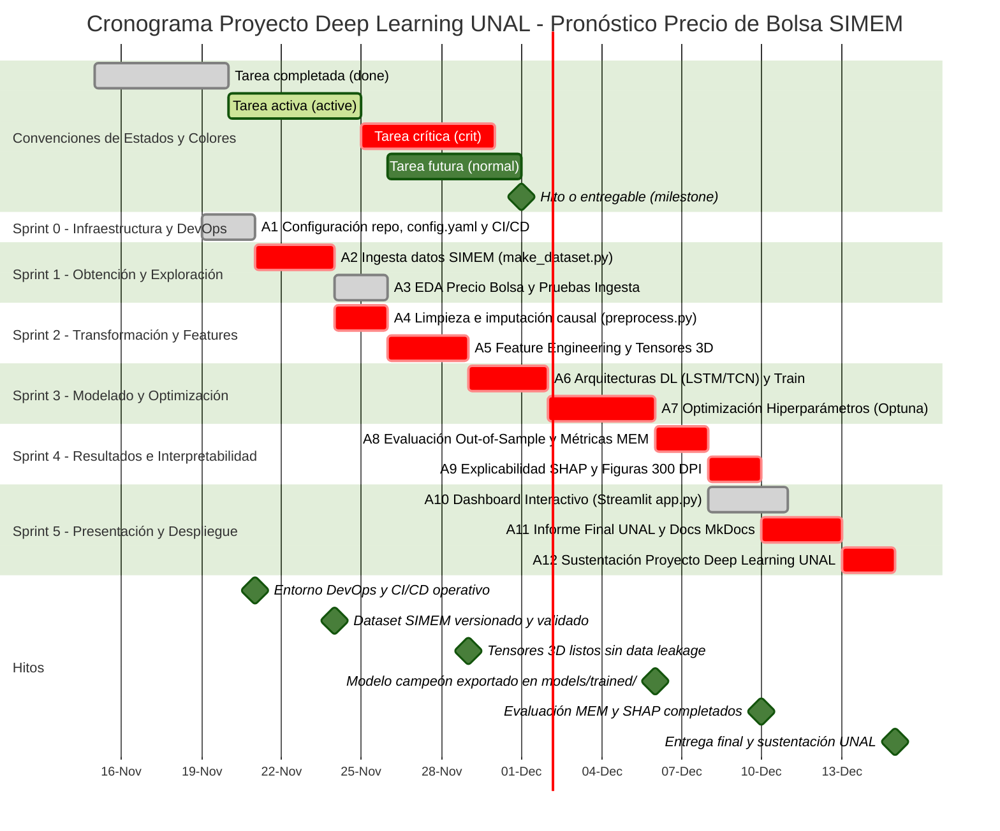

    
    
    

<h2 align="center" style="font-size:1.4em; margin:6px 0;">Deep Learning 2026-2S</h2>
<h3 align="center" style="font-size:1.05em; margin:4px 0;">Proyecto curso - Precio de bolsa energía Colombia</h3>
<h4 align="center" style="font-size:0.9em; margin:4px 0; color:#555;">Modelo pronostico precio de bolsa energía de Colombia</h4>

Departamento de Ciencias de la Computación y de la Decisión 
Facultad de Minas · Universidad Nacional de Colombia 
Docente: John R. Ballesteros

<b>Equipo de trabajo:</b>

<table style="width:100%; font-size:0.72em; line-height:1.25; border-collapse:collapse;">
  <tr>
    <td style="padding:2px 6px;">• Lissy Grace Restrepo Taborda</td>
    <td style="padding:2px 6px;">📧 <i>lrestrepopo@unal.edu.co </i></td>
    <td style="padding:2px 6px;">• Kelly Y. Monsalve Carvajal</td>
    <td style="padding:2px 6px;">📧 <i>kemonsalvec@unal.edu.co</i></td>
  </tr>
  <tr>
    <td style="padding:2px 6px;">• Leidy M. Castaño Hernández</td>
    <td style="padding:2px 6px;">📧 <i>lmcastanoh@unal.edu.co</i></td>
    <td style="padding:2px 6px;">• Kevin F. Hidalgo Higuita</td>
    <td style="padding:2px 6px;">📧 <i>kfhidalgoh@unal.edu.co</i></td>
  </tr>
  <tr>
    <td style="padding:2px 6px;">• Sebastian Sánchez Arango</td>
    <td style="padding:2px 6px;">📧 <i>sebsanchezar@unal.edu.co</i></td>
  </tr>
</table>

📅 26 de Octubre de 2026 ·

<i>Nota: el tema del navegador puede afectar la visualización de la presentación.</i>

## 🕸️ Diagrama de red

```mermaid
%%{init: {'theme':'neo-dark', 'look': 'neo'}}%%
flowchart LR
    %% Definición de colores y estilos
    classDef critical fill:#ffe6e6,stroke:#ff0000,stroke-width:2px,color:#000
    classDef normal fill:#f9f9f9,stroke:#333,stroke-width:1px,color:#000
    classDef legend fill:#ffffff,stroke:#333,stroke-width:1px,color:#000

    %% Leyenda con la convención solicitada
    subgraph Convencion [Convención de Tiempos - Días]
        L["<table style='text-align:center; border-collapse:collapse; font-family:sans-serif; font-size:12px;'><tr><td style='padding:2px 8px;'>PI</td><td style='background-color:yellow; color:black; padding:2px 8px;'>Holgura</td><td style='padding:2px 8px;'>PT</td></tr><tr><td colspan='3' style='border:1px solid black; padding:4px;'>Actividad / Artefacto</td></tr><tr><td style='border:1px solid black; padding:4px;'># ID</td><td style='border:1px solid black; padding:4px;'>Rol</td><td style='border:1px solid black; padding:4px;'>Duración</td></tr><tr><td style='padding:2px 8px;'>UI</td><td></td><td style='padding:2px 8px;'>UT</td></tr></table>"]
    end

    %% SPRINT 0: Infraestructura y DevOps
    A1["<table style='text-align:center; border-collapse:collapse; font-family:sans-serif; font-size:12px;'><tr><td style='padding:2px 8px;'>0</td><td style='background-color:yellow; color:black; padding:2px 8px;'>0</td><td style='padding:2px 8px;'>2</td></tr><tr><td colspan='3' style='border:1px solid black; padding:4px;'>Configuración repo, config.yaml y CI/CD</td></tr><tr><td style='border:1px solid black; padding:4px;'># A1</td><td style='border:1px solid black; padding:4px;'>MLOps</td><td style='border:1px solid black; padding:4px;'>2</td></tr><tr><td style='padding:2px 8px;'>0</td><td></td><td style='padding:2px 8px;'>2</td></tr></table>"]

    %% SPRINT 1: Obtención y Exploración
    A2["<table style='text-align:center; border-collapse:collapse; font-family:sans-serif; font-size:12px;'><tr><td style='padding:2px 8px;'>2</td><td style='background-color:yellow; color:black; padding:2px 8px;'>0</td><td style='padding:2px 8px;'>5</td></tr><tr><td colspan='3' style='border:1px solid black; padding:4px;'>Ingesta datos SIMEM (make_dataset.py)</td></tr><tr><td style='border:1px solid black; padding:4px;'># A2</td><td style='border:1px solid black; padding:4px;'>Data Eng</td><td style='border:1px solid black; padding:4px;'>3</td></tr><tr><td style='padding:2px 8px;'>2</td><td></td><td style='padding:2px 8px;'>5</td></tr></table>"]

    A3["<table style='text-align:center; border-collapse:collapse; font-family:sans-serif; font-size:12px;'><tr><td style='padding:2px 8px;'>5</td><td style='background-color:yellow; color:black; padding:2px 8px;'>2</td><td style='padding:2px 8px;'>7</td></tr><tr><td colspan='3' style='border:1px solid black; padding:4px;'>EDA Precio Bolsa y Pruebas Ingesta</td></tr><tr><td style='border:1px solid black; padding:4px;'># A3</td><td style='border:1px solid black; padding:4px;'>Data Sci</td><td style='border:1px solid black; padding:4px;'>2</td></tr><tr><td style='padding:2px 8px;'>7</td><td></td><td style='padding:2px 8px;'>9</td></tr></table>"]

    %% SPRINT 2: Transformación y Feature Engineering
    A4["<table style='text-align:center; border-collapse:collapse; font-family:sans-serif; font-size:12px;'><tr><td style='padding:2px 8px;'>5</td><td style='background-color:yellow; color:black; padding:2px 8px;'>0</td><td style='padding:2px 8px;'>7</td></tr><tr><td colspan='3' style='border:1px solid black; padding:4px;'>Limpieza e imputación causal (preprocess.py)</td></tr><tr><td style='border:1px solid black; padding:4px;'># A4</td><td style='border:1px solid black; padding:4px;'>Data Eng</td><td style='border:1px solid black; padding:4px;'>2</td></tr><tr><td style='padding:2px 8px;'>5</td><td></td><td style='padding:2px 8px;'>7</td></tr></table>"]

    A5["<table style='text-align:center; border-collapse:collapse; font-family:sans-serif; font-size:12px;'><tr><td style='padding:2px 8px;'>7</td><td style='background-color:yellow; color:black; padding:2px 8px;'>0</td><td style='padding:2px 8px;'>10</td></tr><tr><td colspan='3' style='border:1px solid black; padding:4px;'>Feature Engineering y Tensores 3D</td></tr><tr><td style='border:1px solid black; padding:4px;'># A5</td><td style='border:1px solid black; padding:4px;'>Data Sci</td><td style='border:1px solid black; padding:4px;'>3</td></tr><tr><td style='padding:2px 8px;'>7</td><td></td><td style='padding:2px 8px;'>10</td></tr></table>"]

    %% SPRINT 3: Modelado y Optimización
    A6["<table style='text-align:center; border-collapse:collapse; font-family:sans-serif; font-size:12px;'><tr><td style='padding:2px 8px;'>10</td><td style='background-color:yellow; color:black; padding:2px 8px;'>0</td><td style='padding:2px 8px;'>13</td></tr><tr><td colspan='3' style='border:1px solid black; padding:4px;'>Arquitecturas DL (LSTM/TCN) y Train</td></tr><tr><td style='border:1px solid black; padding:4px;'># A6</td><td style='border:1px solid black; padding:4px;'>DL Eng</td><td style='border:1px solid black; padding:4px;'>3</td></tr><tr><td style='padding:2px 8px;'>10</td><td></td><td style='padding:2px 8px;'>13</td></tr></table>"]

    A7["<table style='text-align:center; border-collapse:collapse; font-family:sans-serif; font-size:12px;'><tr><td style='padding:2px 8px;'>13</td><td style='background-color:yellow; color:black; padding:2px 8px;'>0</td><td style='padding:2px 8px;'>17</td></tr><tr><td colspan='3' style='border:1px solid black; padding:4px;'>Optimización Hiperparámetros (Optuna)</td></tr><tr><td style='border:1px solid black; padding:4px;'># A7</td><td style='border:1px solid black; padding:4px;'>DL Eng</td><td style='border:1px solid black; padding:4px;'>4</td></tr><tr><td style='padding:2px 8px;'>13</td><td></td><td style='padding:2px 8px;'>17</td></tr></table>"]

    %% SPRINT 4: Resultados e Interpretabilidad
    A8["<table style='text-align:center; border-collapse:collapse; font-family:sans-serif; font-size:12px;'><tr><td style='padding:2px 8px;'>17</td><td style='background-color:yellow; color:black; padding:2px 8px;'>0</td><td style='padding:2px 8px;'>19</td></tr><tr><td colspan='3' style='border:1px solid black; padding:4px;'>Evaluación Out-of-Sample y Métricas MEM</td></tr><tr><td style='border:1px solid black; padding:4px;'># A8</td><td style='border:1px solid black; padding:4px;'>Quant</td><td style='border:1px solid black; padding:4px;'>2</td></tr><tr><td style='padding:2px 8px;'>17</td><td></td><td style='padding:2px 8px;'>19</td></tr></table>"]

    A9["<table style='text-align:center; border-collapse:collapse; font-family:sans-serif; font-size:12px;'><tr><td style='padding:2px 8px;'>19</td><td style='background-color:yellow; color:black; padding:2px 8px;'>0</td><td style='padding:2px 8px;'>21</td></tr><tr><td colspan='3' style='border:1px solid black; padding:4px;'>Explicabilidad SHAP y Figuras 300 DPI</td></tr><tr><td style='border:1px solid black; padding:4px;'># A9</td><td style='border:1px solid black; padding:4px;'>Data Sci</td><td style='border:1px solid black; padding:4px;'>2</td></tr><tr><td style='padding:2px 8px;'>19</td><td></td><td style='padding:2px 8px;'>21</td></tr></table>"]

    %% SPRINT 5: Presentación y Despliegue
    A10["<table style='text-align:center; border-collapse:collapse; font-family:sans-serif; font-size:12px;'><tr><td style='padding:2px 8px;'>19</td><td style='background-color:yellow; color:black; padding:2px 8px;'>0</td><td style='padding:2px 8px;'>22</td></tr><tr><td colspan='3' style='border:1px solid black; padding:4px;'>Dashboard Interactivo (Streamlit app.py)</td></tr><tr><td style='border:1px solid black; padding:4px;'># A10</td><td style='border:1px solid black; padding:4px;'>MLOps</td><td style='border:1px solid black; padding:4px;'>3</td></tr><tr><td style='padding:2px 8px;'>19</td><td></td><td style='padding:2px 8px;'>22</td></tr></table>"]

    A11["<table style='text-align:center; border-collapse:collapse; font-family:sans-serif; font-size:12px;'><tr><td style='padding:2px 8px;'>21</td><td style='background-color:yellow; color:black; padding:2px 8px;'>0</td><td style='padding:2px 8px;'>24</td></tr><tr><td colspan='3' style='border:1px solid black; padding:4px;'>Informe Final UNAL y Docs MkDocs</td></tr><tr><td style='border:1px solid black; padding:4px;'># A11</td><td style='border:1px solid black; padding:4px;'>Tech Lead</td><td style='border:1px solid black; padding:4px;'>3</td></tr><tr><td style='padding:2px 8px;'>21</td><td></td><td style='padding:2px 8px;'>24</td></tr></table>"]

    A12["<table style='text-align:center; border-collapse:collapse; font-family:sans-serif; font-size:12px;'><tr><td style='padding:2px 8px;'>22</td><td style='background-color:yellow; color:black; padding:2px 8px;'>0</td><td style='padding:2px 8px;'>24</td></tr><tr><td colspan='3' style='border:1px solid black; padding:4px;'>Sustentación Proyecto Deep Learning UNAL</td></tr><tr><td style='border:1px solid black; padding:4px;'># A12</td><td style='border:1px solid black; padding:4px;'>Equipo</td><td style='border:1px solid black; padding:4px;'>2</td></tr><tr><td style='padding:2px 8px;'>22</td><td></td><td style='padding:2px 8px;'>24</td></tr></table>"]

    %% Secuencia y Dependencias
    A1 --> A2
    A2 --> A3
    A2 --> A4
    A3 --> A5
    A4 --> A5
    A5 --> A6
    A6 --> A7
    A7 --> A8
    A8 --> A9
    A8 --> A10
    A9 --> A11
    A10 --> A12
    A11 --> A12

    %% Tabla de precedencias
    %% Actividad | Predecesora | Duración
    %% A1        | -           | 2
    %% A2        | A1          | 3
    %% A3        | A2          | 2
    %% A4        | A2          | 2
    %% A5        | A3, A4      | 3
    %% A6        | A5          | 3
    %% A7        | A6          | 4
    %% A8        | A7          | 2
    %% A9        | A8          | 2
    %% A10       | A8          | 3
    %% A11       | A9          | 3
    %% A12       | A10, A11    | 2

    %% Aplicar estilos según ruta crítica
    class L legend
    class A1,A2,A4,A5,A6,A7,A8,A9,A11,A12 critical
    class A3,A10 normal
```

<!-- prettier-ignore -->

Notas sobre la lógica de red y ruta crítica Paralelismo real en el proyecto:

Tras descargar los datos de SIMEM (A2), el análisis exploratorio (A3) y la limpieza causal (A4)
avanzan en paralelo antes de converger en la ingeniería de características (A5).

Tras evaluar el modelo campeón (A8), el desarrollo del dashboard en Streamlit (A10) se ejecuta en
paralelo con la generación de explicabilidad SHAP (A9) y la redacción del informe final UNAL (A11).

Ruta Crítica (Holgura = 0): A1 → A2 → A4 → A5 → A6 → A7 → A8 → A9 → A11 → A12 (duración total de 24
días; nota: la rama A8 → A10 → A12 suma 19 + 3 + 2 = 24 días, por lo que también es crítica).

## 📅 Diagrama de Gantt

<!-- prettier-ignore -->

